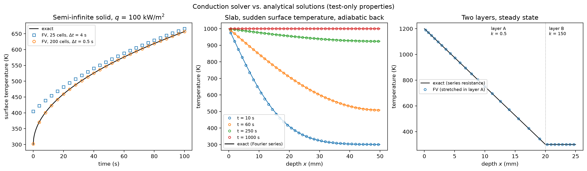
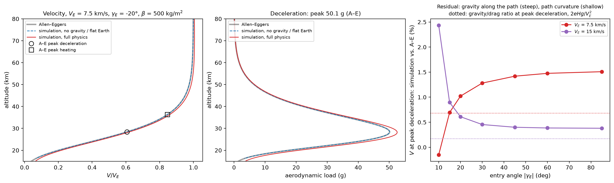
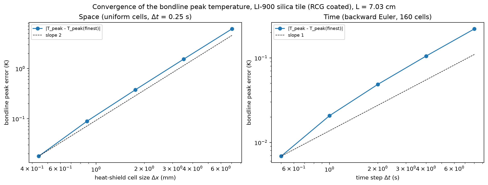
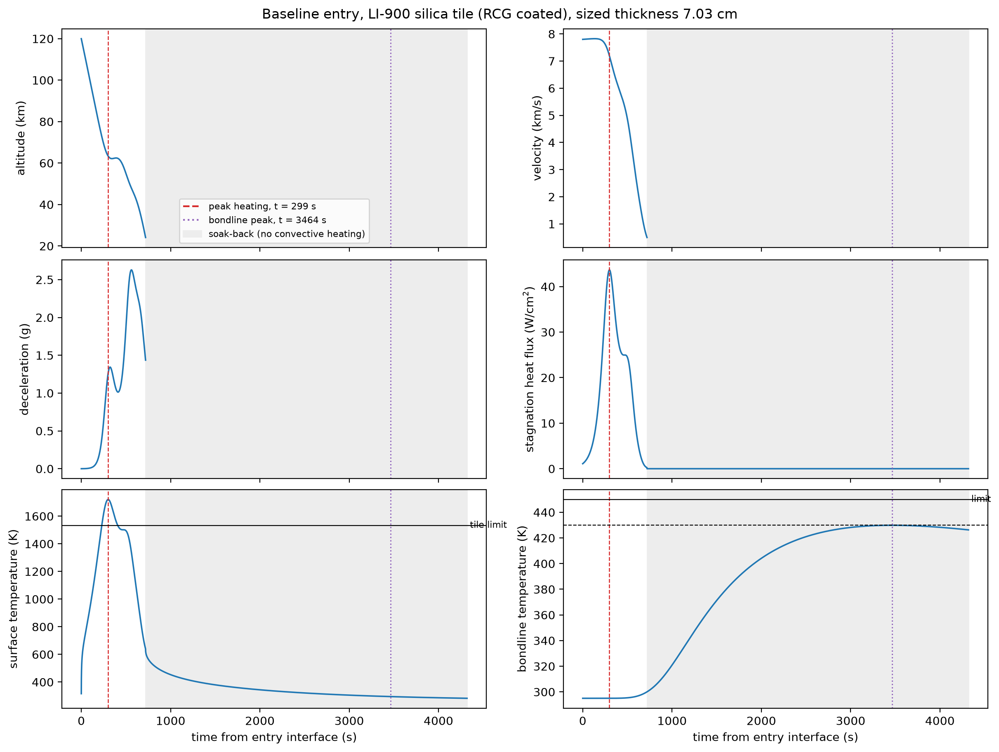
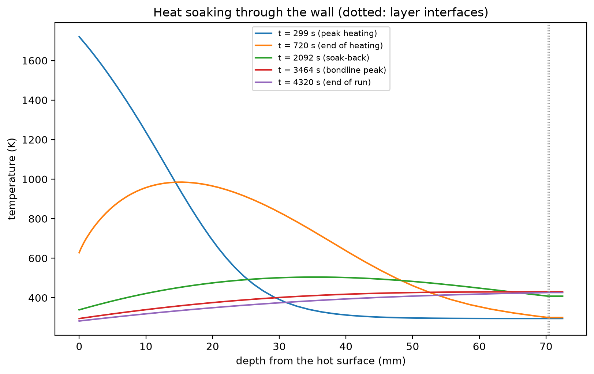
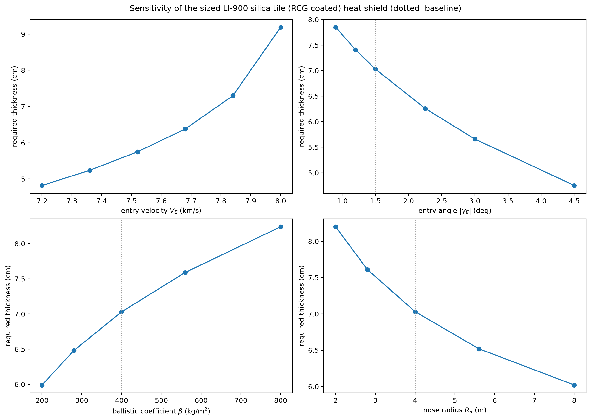
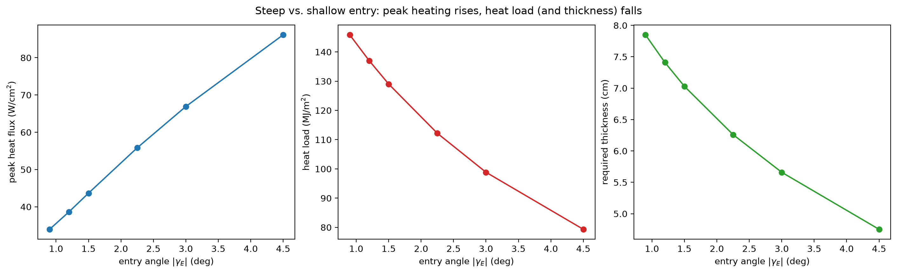
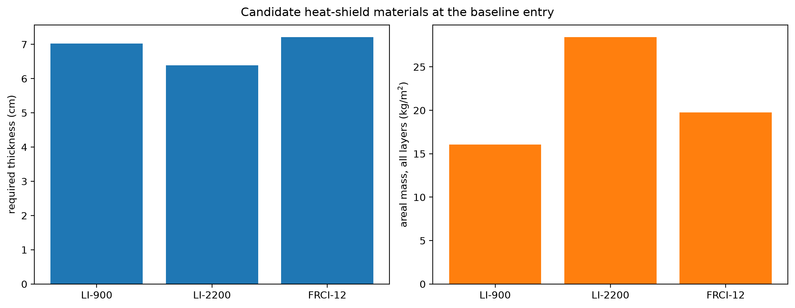

# Reentry Heating & TPS Thermal Model

**[▶ Try it in your browser](https://badrelsayednyu.github.io/reentry-tps/)** — interactive version that runs the same model live. Includes temperature profiles through the wall, parameter studies with CSV export, published validation figures, and controls for layer thicknesses, initial temperature, grid, time step, soak-back window and the hot-wall correction.

How thick does a capsule's heat shield have to be? This project answers that by coupling three
models — an entry trajectory, a stagnation-point heating correlation, and a transient multi-layer
conduction model of the wall — and searching for the thinnest heat shield that keeps the bondline
(the adhesive between the tiles and the aluminium structure) below its temperature limit, including
the heat that keeps soaking inward long after the heating has stopped.

> **Result.** Sized to a 430 K bondline, the baseline entry needs **7.0 cm of LI-900** (16.0 kg/m²
> for the whole wall). The surface still reaches **1721 K**, above LI-900's 1533 K reuse limit.
> **FRCI-12** is the lightest of the three tiles that stays inside its own limit.

## Why this matters

Aerothermodynamic heating is the defining constraint of entry-vehicle design. A capsule returning
from low Earth orbit converts roughly 30 MJ of kinetic energy per kilogram of vehicle into heat in
the shock layer; most of it is carried away by the flow, but the fraction that reaches the surface
still drives the vehicle's mass. Thermal-protection mass is paid for on every flight, so sizing it
accurately — not just conservatively — matters.

## The three coupled models

**1. Trajectory** — planar point mass over a non-rotating spherical Earth (`src/tps/trajectory.py`):

$$\dot V = -\frac{D}{m} - g\sin\gamma,\qquad
\dot\gamma = \frac{1}{V}\Big[\frac{L}{m} - \Big(g - \frac{V^2}{R_E+h}\Big)\cos\gamma\Big],\qquad
\dot h = V\sin\gamma$$

with $D/m = \rho V^2/2\beta$, $L = (L/D)\,D$, $g = g_0 (R_E/(R_E+h))^2$ and an exponential
atmosphere $\rho = \rho_0 e^{-h/H}$ ($H$ = 7.2 km). Integrated with RK45 (rtol 1e-8) from the
120 km entry interface to $V$ = 500 m/s; skip-out is detected.

**2. Stagnation-point heating** — Sutton–Graves (`src/tps/heating.py`):

$$q_{conv} = k\,\sqrt{\rho/R_n}\,V^3,\qquad k = 1.7415\times10^{-4}\ \mathrm{kg^{1/2}/m}$$

with an optional hot-wall correction $q(1 - h_w/h_0)$, and re-radiation from the surface:
$-k\,\partial T/\partial x|_0 = q_{conv} - \varepsilon\sigma(T_s^4 - T_\infty^4)$, where $T_\infty$ comes from
the 1976 U.S. Standard Atmosphere (checked against the printed tables at six altitudes).

**3. Wall conduction** — $\rho c_p(T)\,\partial T/\partial t = \partial_x(k(T)\,\partial_x T)$ through
[heat shield | bondline | structure] (`src/tps/conduction.py`):
- implicit finite volume (backward Euler, Crank–Nicolson option), tridiagonal solve per step;
- cells never straddle a layer boundary; series (harmonic-mean) conductance at interfaces;
- geometric stretching clusters cells at the hot surface;
- energy-conserving enthalpy form with temperature-dependent $k$ and $c_p$; the $T^4$ boundary
  condition is Newton-linearized and iterated to 1e-6 K each step;
- the run continues after heating ends (soak-back) until the bondline peak has passed.

If the peak remains unconfirmed at the maximum soak time, sizing stops with an error rather than
using an incomplete temperature maximum. The default maximum is four hours after heating ends;
set `numerics.max_soak_time` (seconds) in the baseline YAML for cases needing a longer cooling run.
The browser app applies the same check and reports when it cannot confirm a sizing result.

**Sizing** (`src/tps/sizing.py`): Brent's method on the heat-shield thickness, such that the peak
bondline temperature equals the limit minus a margin. The result is never thinner than needed and
at most 0.1 mm thicker.

## Assumptions

- Non-ablating wall: a reusable conduction/re-radiation system (ceramic tiles), no pyrolysis or
  surface recession.
- No shock-layer radiative heating (valid below about 10 km/s, i.e. for low-Earth-orbit returns).
- Stagnation point only, one-dimensional conduction through the wall.
- The tile coating is represented only by its emissivity; the strain-isolation pad used on the
  Space Shuttle between tile and adhesive is not modelled.
- Tile conductivity at 1 atm (the highest value in the tables, conservative for the bondline; the
  bondline peaks during soak-back, low in the atmosphere).

## Materials

All properties are from NASA RP-1289, *Thermal Protection Materials: Thermophysical Property Data*
(Williams & Curry, 1992), transcribed in their printed units with page citations in
[`data/materials.yaml`](data/materials.yaml) and converted to SI on loading.

| Layer | Material | Density (kg/m³) | Max use temperature (K) |
|---|---|---|---|
| Heat shield | LI-900 silica tile | 144 | 1533 |
| Heat shield | LI-2200 silica tile | 352 | 1756 |
| Heat shield | FRCI-12 fibrous composite | 192 | 1756 |
| Coating | RCG, emissivity 0.85 | — | — |
| Bondline | RTV-560 silicone adhesive | 1410 | 561 |
| Structure | Aluminium 2219 | 2813 | 450 |

## Validation

### Conduction solver vs. analytical solutions



| Case | Reference | Result |
|---|---|---|
| Semi-infinite solid, constant flux | $T_s - T_i = (2q/k)\sqrt{\alpha t/\pi}$ | within 0.5%; first order in time, second order in space, as designed |
| Finite slab, sudden surface temperature | Fourier series | within 0.2% of the temperature step |
| Two-layer steady state | series thermal resistance | exact to round-off; slope ratio = inverse conductivity ratio |
| $k(T) = a + bT$ steady state | Kirchhoff transform | second-order convergence |
| Constant heating with re-radiation | radiative equilibrium $\varepsilon\sigma(T^4 - T_\infty^4) = q$ | to 1e-6 |
| **Energy conservation** with radiation and tabulated $k(T)$, $c_p(T)$ | $\int(q_{in} - q_{rad} - q_{back})\,dt = \Delta E_{stored}$ | **closes to 1e-13** (spec: 0.1%) |

### Trajectory vs. Allen–Eggers



Allen & Eggers' ballistic solution assumes constant flight-path angle and no gravity. With gravity
and curvature switched off, the integrated trajectory reproduces it to 1e-6. With full physics, on
the steep ballistic case ($V_E$ = 7.5 km/s, $\gamma_E$ = −20°, $\beta$ = 500 kg/m²):

| | Allen–Eggers | Simulation | Difference |
|---|---|---|---|
| $V/V_E$ at peak deceleration | $e^{-1/2}$ = 0.6065 | 0.6127 | +1.0% |
| $V/V_E$ at peak heating | $e^{-1/6}$ = 0.8465 | 0.8571 | +1.25% |
| Peak deceleration | 50.1 g | 52.6 g | +4.9% |

The residual is the gravity component along the path, which Allen–Eggers neglects: it keeps the
vehicle slightly faster at every altitude. Its size relative to drag at peak deceleration is
$2eHg/V_E^2$, so doubling the entry speed should cut it about fourfold — the simulation shows
exactly that (right panel). For shallow entries, path curvature takes over as the dominant effect.

### Grid and time-step convergence



At the sized thickness, the bondline peak converges at second order in cell size and first order
in time, which is what backward Euler should do. From 40 to 320 uniform cells the error falls from
0.38 K to under 0.02 K. The production run (60 cells, stretched toward the hot surface, Δt = 0.5 s)
sits inside that band: the uniform-grid study is already within 0.1 K at 80 cells, and within
0.01 K at Δt = 0.5 s.

## Baseline case

A representative low-Earth-orbit lifting capsule, stated as a design assumption in
[`data/baseline.yaml`](data/baseline.yaml):

| Input | Value | Basis |
|---|---|---|
| Entry speed | 7.8 km/s | circular-orbit speed; keeps the no-radiation, non-ablating assumptions valid |
| Entry angle | −1.5° | shallow lifting corridor |
| Ballistic coefficient | 400 kg/m² | assumed |
| L/D | 0.3 | Apollo command-module trim |
| Nose radius | 4 m | assumed blunt capsule |
| Heat shield | LI-900, sized | NASA RP-1289 |
| Bondline / structure | 0.2 mm RTV-560, 2 mm Al 2219 | assumed layup; thicknesses are not in RP-1289 |
| Initial temperature | 295 K | wall at room temperature before entry |
| Bondline limit | 450 K, sized to 430 K | Al 2219 maximum-use temperature, RP-1289 p. 19-2; 20 K is a design margin |

The aluminium limit governs. RTV-560's own limit is 561 K, and the adhesive sits on the skin.

## Results

### Time histories



| Quantity | Value |
|---|---|
| Sized LI-900 thickness | 7.03 cm |
| Areal mass, all layers | 16.04 kg/m² (10.1 kg/m² of tile, 5.9 kg/m² of adhesive and skin) |
| Peak heat flux | 43.7 W/cm² at t = 299 s |
| Heat load | 129 MJ/m² |
| Peak deceleration | 2.63 g |
| Peak surface temperature | 1721 K, above the 1533 K tile limit |
| Peak bondline temperature | 429.9 K at t = 3464 s (target 430 K) |

The entry is shallow enough to lift. The vehicle checks its descent, which puts a second peak on
the deceleration and a shoulder on the heat pulse. Peak heating is at five minutes. The bondline
does not peak until nearly an hour later, after convective heating has already ended: the heat
soaks inward through the tile. That delay is why the conduction run continues past the trajectory.



At peak heating the gradient is confined to the outer tile. By the bondline peak the wall has
evened out near 430 K. The adhesive and the skin are 2.2 mm combined, so they sit on top of each
other at the right-hand edge of the plot.

### What the thickness depends on



For one tile material the areal mass moves with thickness (the adhesive and skin do not change),
so the plots show thickness. The mass for every point is in
[`results/sweeps.md`](results/sweeps.md).

- **Entry angle** is the classic trade. From 0.9° to 4.5° the peak flux rises from 34 to 86 W/cm²,
  the heat load falls from 146 to 79 MJ/m², and the tile thins from 7.9 to 4.8 cm. A steeper entry
  is a hotter, shorter pulse, and the bondline cares about the load, not the peak.
- **Entry speed**, on this lifting path, does the opposite of a steep ballistic entry. From 7.2 to
  8.0 km/s the vehicle rides higher, so the peak flux falls (60 to 35 W/cm²) while the pulse lasts
  longer. Heat load rises from 74 to 183 MJ/m² and the tile grows from 4.8 to 9.2 cm.
- **Ballistic coefficient.** A heavier vehicle glides in denser air. Thickness grows from 6.0 cm
  at 200 kg/m² to 8.2 cm at 800 kg/m². Peak deceleration stays at 2.63 g: on this path the load
  factor is set by L/D, not by β.
- **Nose radius.** Heating scales as 1/√Rₙ. Doubling the nose from 4 m to 8 m cuts the heat load
  from 129 to 91 MJ/m² and thins the tile from 7.0 to 6.0 cm.



### Which tile



All three coatings are the same RCG (ε = 0.85), so the surface temperature is set by re-radiation
and is almost the same, about 1710–1720 K. What changes is whether that temperature is allowed.

| Material | Thickness | Areal mass | Peak surface | Limit | Usable here |
|---|---|---|---|---|---|
| LI-900 | 7.03 cm | 16.0 kg/m² | 1721 K | 1533 K | no |
| LI-2200 | 6.39 cm | 28.4 kg/m² | 1711 K | 1756 K | yes |
| FRCI-12 | 7.21 cm | 19.8 kg/m² | 1718 K | 1756 K | yes |

LI-900 is the lightest wall and the one the bondline constraint would pick, and it overheats its
surface. LI-2200 survives and is slightly thinner, but it is more than twice as dense, so the wall
is the heaviest. FRCI-12 stays under its limit at 19.8 kg/m², 8 kg/m² lighter than LI-2200. For
this entry it is the tile to fly.

## Limitations and next steps

- **Stagnation point only.** Next: Lees' laminar heating distribution around the blunt body, to size
  the shield away from the nose.
- **No ablation.** Next: pyrolysis and surface recession for ablative heat shields (Avcoat, PICA),
  needed for faster lunar and Mars returns.
- **No shock-layer radiation**, which becomes significant above roughly 10 km/s.
- **Simplified atmosphere** for the trajectory (exponential).
- **A correlation instead of a flow solution.** In blunt-body CFD, a resolved shock layer gives the
  wall heat flux directly; replacing Sutton–Graves with CFD heating at a few trajectory points is
  the natural link between this model and that work.

## Running it

```bash
python -m venv .venv && source .venv/bin/activate
pip install -e ".[dev]"
pytest                          # validation suite
node --test tests/test_browser.cjs  # browser model regression checks (Node.js 22+)
python scripts/make_figures.py  # every figure and results table
```

Design inputs live in [`data/baseline.yaml`](data/baseline.yaml) and
[`data/materials.yaml`](data/materials.yaml); the scripts refuse to run while any value is still
marked TODO.

## References

- Allen, H. J.; Eggers, A. J.: *A Study of the Motion and Aerodynamic Heating of Ballistic Missiles
  Entering the Earth's Atmosphere at High Supersonic Speeds*, NACA Report 1381, 1958.
- Sutton, K.; Graves, R. A.: *A General Stagnation-Point Convective-Heating Equation for Arbitrary
  Gas Mixtures*, NASA TR R-376, 1971.
- Williams, S. D.; Curry, D. M.: *Thermal Protection Materials: Thermophysical Property Data*,
  NASA RP-1289, 1992.
- *U.S. Standard Atmosphere, 1976*, NOAA-S/T 76-1562.
- Anderson, J. D.: *Hypersonic and High-Temperature Gas Dynamics*, AIAA.
- Incropera, F. P. et al.: *Fundamentals of Heat and Mass Transfer*, Wiley.
- Patankar, S. V.: *Numerical Heat Transfer and Fluid Flow*, Hemisphere, 1980.
